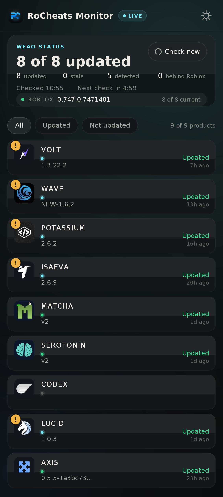
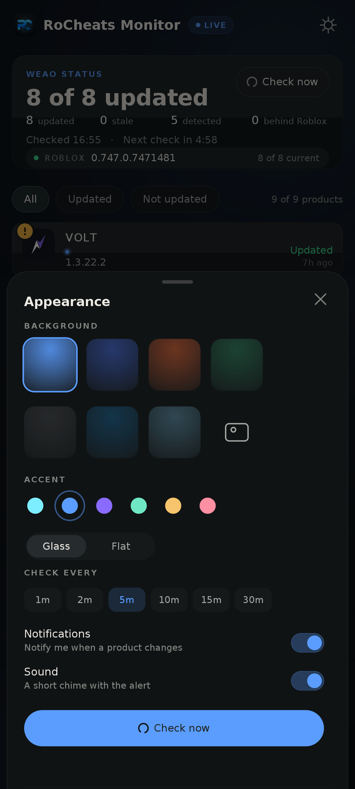

# RoCheats Monitor

A small Windows tray app, with an Android twin. It watches nine products through the
public WEAO API and raises a notification when one of them changes status — and it
watches Roblox itself, so a new client build is noticed within seconds of shipping.





## Roblox update detection

Both builds poll `clientsettingscdn.roblox.com/v2/client-version/WindowsPlayer` every
**20 s**, independently of the product poll. When the upload hash changes the app fires a
"Roblox updated" notification, pulses the build strip, and refreshes the feed straight
away, because every product's currency just changed.

Each product's `rbxversion` is compared with that live hash, so the hero counts how many
are **behind Roblox** and a lagging row gets an amber `▲` after its version:

```
ROBLOX 0.747.0.7471481                    8 of 8 current
```

## Three builds, one design

| Build | Files | Notes |
| --- | --- | --- |
| Windows | `src/main.cpp`, `build.sh` → `RoCheatsMonitor.exe` | Win32 + GDI+, no dependencies, tray icon |
| Android | `android/` → `RoCheatsMonitor.apk` | plain `aapt2`/`javac`/`d8` build, no Gradle, no libraries |
| Web | `web/` → static site | no build step, no framework; deploy the folder anywhere |

All three share the same palette, spacing and copy, so a screenshot from one is
recognisable in another.

## Make it yours

- **Background:** six built-in scenes (aurora, midnight, ember, forest, carbon, ocean),
  a picture of your own, or a colour of your own that cycles through six options.
- **Material:** liquid glass (frosted, blends the scene behind it) or flat.
- **Accent:** six preset tints for the whole UI — pills, marks, switches and the tint in the
  backdrop all follow it.

## Run it

`RoCheatsMonitor.exe` is self-contained: no installer and nothing else to
download. It needs 64-bit Windows 10 or 11.

The exe is not code-signed, so the first launch shows "Windows protected your
PC". Choose **More info**, then **Run anyway**.

## Opening

The app opens on a wordmark: the RC monogram over a large, out-of-focus copy of itself, with
**ROCHEATS STATUS CHECKER** across it and a hairline that fills while the first check runs.
It holds, then dissolves into the checker — once per launch.

## Look

Cool, slightly green-grey glass with a single cyan accent — the same design
family as [Unnamed Enhancements](https://github.com/7n8s/UnnamedEnhancements):
warm off-white type on near-black, hairline card edges, wide-tracked eyebrow
labels, a soft accent wash in the summary card, and accent-tinted pills for
whatever is selected. Large radii, one shadow per card, no gradients on text.

## The dashboard

- **Icon rail:** the status view, settings, and the app mark (a click checks now).
- **Icon rail:** brand mark (a click checks now), status, settings.
- **Summary card:** how many tracked products are updated, the split between
  updated, not updated and detected, when the last check ran, a countdown to the
  next one, and a **Check now** button (F5 does the same).
- **Filters:** All / Updated / Not updated, with a live count.
- **Product rows:** each product's own artwork, update status, Hyperion detection
  and the version WEAO lists.
- **Updated** is what the RoCheats status post calls "Working"; **Not updated** is "Down".
- Updated does not mean undetected. Detection has its own label for that reason.
- **Rows are not buttons.** Clicking a product does nothing; only the small
  detection badge on its artwork toggles that product's alerts.
- **Detection badge:** a small exclamation mark on the corner of the artwork means
  the tool is detected by Hyperion; hovering it (tapping it on Android) says
  "Detected". Clicking the badge turns alerts for that product on or off, and a
  muted product's badge is dimmed with a slash. Nothing else in the row reacts.
- A row glows for a moment when its status changes.
- Changing the filter slides the rows from where they were to where they now
  belong, rather than snapping.

## Settings

The sliders button on the rail opens the settings panel. On a wide screen it
opens beside the list and the window grows to fit; on a narrow one it slides
over the list. It holds:

- check interval, 1 to 30 minutes (5 by default)
- desktop notifications and their sound
- start with Windows
- a button that sends a test notification
- **background:** six built-in scenes, a picture of your own (PNG, JPEG, BMP or
  GIF, cropped to fill), or a plain colour you cycle through
- **theme:** *Liquid glass* or *Flat*

## Themes

*Liquid glass* blurs and tints whatever is behind each panel, brightens the rim
where light would catch it, and lets the backdrop show through the edge, so the
picture or scene behind reads through the cards. Each pane adds tint in
proportion to how bright its backdrop is, which keeps the text legible over a
light picture. *Flat* skips all of that: opaque cards that suit a plain colour.

Switching backgrounds cross-fades, and the settings panel slides in and out, so
nothing snaps.

## CODEX

No public feed reports a status for CODEX at the moment (checked 11 November 2026):

- WEAO does not list it.
- rocheats.com does not either. Its status page is a WEAO feed of 29 tools and
  CODEX is not one of them, and the store catalogue has no CODEX product.
- codex.lol publishes no status.
- ScriptBlox has a CODEX entry, but it is for the Android build and has not
  changed since 3 July 2026, so the app does not use it.

The card therefore says "No live source". It starts working by itself as soon as
WEAO lists CODEX.

## Tray

Closing the window leaves the app running in the notification area. Windows may
tuck the icon behind the `^` arrow; drag it onto the taskbar to keep it visible.

- Click the icon to open the window.
- Right-click it for **Check now**, **Send test notification** and **Exit**.

## Notifications

An alert is raised only when a status that was already known changes, so the
first run and restarts are silent.

Windows decides how alerts are displayed. Do Not Disturb hides the banners and
sends them to the notification centre instead, and Windows 11 switches it on by
itself during full-screen games (Settings > System > Notifications).

## Where things are stored

Everything is in `%APPDATA%\RoCheatsMonitor\settings.ini`, including the last
known statuses.

- To track other products, close the app and edit the `Products=` line. Use the
  names shown on <https://weao.xyz>, separated by commas, 16 at most.
- To reset, delete the `RoCheatsMonitor` folder.
- "Start with Windows" adds one value named `RoCheatsMonitor` under
  `HKCU\Software\Microsoft\Windows\CurrentVersion\Run`. Switching it off removes it.

## Network

Each check is one request: `GET https://weao.xyz/api/status/exploits`, with the
`WEAO-3PService` user agent that WEAO asks third-party tools to send. If that
host is unreachable it tries `whatexpsare.online`, then `weao.gg`. The app
contacts nothing else.

## Build from source

```
sudo apt install g++-mingw-w64-x86-64 python3-pil    # Debian or Ubuntu
bash build.sh
```

| File | Contents |
|---|---|
| `src/main.cpp` | The application |
| `src/canvas.h` | The drawing code (anti-aliased shapes on a bitmap) |
| `src/json.h` | JSON reader |
| `res/` | Icon, manifest and version resource |
| `tools/make_icon.py` | Generates `res/app.ico` |
| `tools/make_images.py` | Packs `assets/` into `res/logos.bin` (the product artwork) |
| `assets/` | The official artwork, as downloaded from each product |
| `web/` | The same checker as a static site, for the browser (`web/README.md`) |
| `android/` | The same checker as an APK (`android/README.md`) |

The artwork in `assets/` comes from the products themselves: WEAO's CDN for
Volt, Wave, Potassium, Isaeva and Seliware, ScriptBlox for Matcha and Serotonin,
getlucid.gg, useaxis.cc and codex.lol for Lucid, Axis and Codex.

The screenshots were captured under Wine at 100% scale with live data, using a
stand-in for the Segoe UI font. On Windows 11 the window also has rounded corners.

The palette follows the RoCheats storefront: a near-black base, out-of-focus blue
and violet lights behind the summary, and one blue accent. Status colours are
green, red and amber, so they read at a glance and never clash with the decor.
The blur, the sheens and the rim highlights are drawn by hand in
`src/canvas.h`/`src/main.cpp`, so the glass theme costs nothing from the system.
